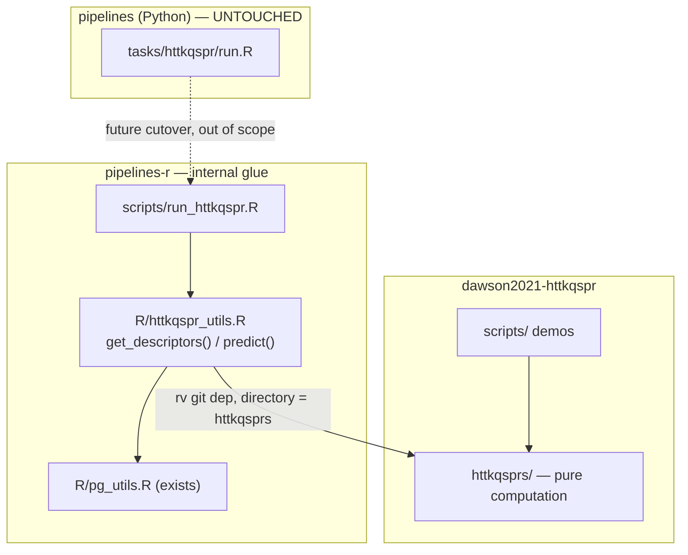

# Decoupling `httkqsprs` from the internal database via `pipelines-r`

**Date:** 2026-09-23
**Status:** Approved design, pending implementation plan
**Branch:** `refactor/decouple-db-access` (this repo), `feat/httkqspr-support` (`pipelines-r`)

## Purpose

`pipelines-r` already acts as a thin layer between the `pipelines` Python package
and the `QSUR` R package: it owns the internal-database queries, calls the
modeling package, and returns tidy frames. This design applies that same pattern
to `httkqsprs`.

Today `httkqsprs` contains its own database access (`get_opera.R`, `get_padel.R`,
`pg_utils.R`), and `calc_clint()` / `calc_fup()` / `calc_papp()` query the CIRI
database directly whenever a `chems` argument is supplied. That couples the
package to an internal schema it should know nothing about, and it blocks the
stated goal of eventually releasing `httkqsprs` publicly.

After this work:

- `httkqsprs` is a pure-computation package — descriptors in, predictions out.
  No `DBI`, no `RPostgres`, no knowledge that a CIRI database exists.
- `pipelines-r` owns OPERA/PaDEL retrieval and the database-facing output
  column contract.
- Internal users supply a list of chemical IDs and `pipelines-r` fetches
  descriptors for them. External users obtain OPERA and PaDEL CSVs by their
  own means and call `generate_preds()`.

### Success criteria

1. `httkqsprs` has no database dependency and is publishable as-is.
2. Predictions are bit-for-bit identical to current `main` for both the CSV path
   and the database path.
3. `pipelines-r` exposes `get_descriptors()` / `predict()` mirroring
   `qsur_utils.R`, and emits the same three CSV strings the Python task already
   reads by name.
4. The `pipelines` Python repo is unchanged.

### Non-goals

- Any change to the `pipelines` Python repo. The cutover of
  `tasks/httkqspr/run.R` to `box::use` against `pipelines-r` is a follow-on
  task with its own plan.
- Splitting `httkqsprs` into its own public repository. This work is the
  prerequisite for that, not that move itself.
- Changes to model objects, model fitting, or prediction math.

## Current state

### `dawson2021-httkqspr` (this repo)

```text
httkqsprs/R/
  calc_clint.R      derives descriptors, queries DB or reads CSV, predicts
  calc_fup.R        same shape
  calc_papp.R       same shape, plus fraction_neutral via httk::calc_ionization
  calc_roy_ad.R     applicability-domain metrics
  generate_preds.R  orchestrates all three, writes six CSVs
  get_opera.R       DB: OPERA descriptors            <- moves to pipelines-r
  get_padel.R       DB: PaDEL descriptors            <- moves to pipelines-r
  pg_utils.R        connection/query/escape helpers  <- deleted (duplicate)
  data.R
scripts/
  CIWorkflowDemo.R        exercises the DB path
  ExternalWorkflowDemo.R  exercises the CSV path
  NewHTTK_April_2026-smi_OPERA2.9Pred.csv          6.8 MB, 4052 chemicals
  NewHTTK_April_2026_QSAR-ready_smi_PadelDesc.csv   69 MB, 4052 chemicals
  Novel_{clint,fup,papp}_predictions_with_AD_*.csv  candidate golden outputs
  Incomplete_*.csv                                  excluded-chemical records
```

Each `calc_*` derives its own descriptor list and fires its own OPERA and PaDEL
queries — six queries per run.

### `pipelines-r`

```text
R/pg_utils.R      production connection/query helpers
R/qsur_utils.R    get_toxprints(con, chem_ids); predict(toxprints)
scripts/run_qsur.R
rproject.toml     QSUR via git dependency on HumanExposure/qsur
```

### `pipelines` (Python, unchanged)

`src/pipelines/tasks/httkqspr/run.R` sets `working_dir` to a checkout of this
repo, calls `devtools::load_all("httkqsprs")` and
`generate_preds(run_name, chems = chem_ids, write.files = FALSE)`, then reshapes
the output with `dplyr::select()` into three CSV strings that `run.py` reads.

## Architecture



### Ownership boundaries

| Concern | Owner |
|---|---|
| Fitted models, training means/SDs | `httkqsprs` |
| Which descriptors each model needs | `httkqsprs` |
| Standardization, prediction, Roy AD | `httkqsprs` |
| Reading user-supplied OPERA/PaDEL CSVs | `httkqsprs` (`generate_preds()`) |
| OPERA/PaDEL SQL and schema name mangling | `pipelines-r` |
| Database-facing output column names | `pipelines-r` |
| Chunking, parallelism, persistence | `pipelines` (Python) |

### Dependency wiring

`pipelines-r/rproject.toml` gains:

```toml
{ name = "httkqsprs", git = "https://github.com/ULRI-CIRI/dawson2021-httkqspr", branch = "main", directory = "httkqsprs" }
```

`rv` supports a `directory` field on git dependencies, so the package can stay
in its subdirectory. During development `branch` points at
`refactor/decouple-db-access`; it flips to `main` at merge time.

**Deployment risk.** `QSUR` resolves from a public repository, but
`ULRI-CIRI/dawson2021-httkqspr` is private and `rv` shells out to the `git` CLI.
Whatever host runs the pipeline needs SSH keys or a credential helper. This must
be verified early rather than discovered at cutover.

## Component design

### `httkqsprs/R/descriptors.R` (new)

```r
required_descriptors(endpoint = c("clint", "fup", "papp"))
# -> list(opera = <character>, padel = <character>)
```

Each branch is a verbatim lift of the derivation block currently at the top of
the corresponding `calc_*` function:

| Endpoint | OPERA | PaDEL |
|---|---|---|
| `clint` | `intersect(paste0(Descriptors$Opera, "_pred"), rownames(importance(ClintClass3Mod)))` | `intersect(Descriptors$Padel, rownames(importance(ClintClass3Mod)))` |
| `fup` | `paste0(str_remove(grep("^Opera_", fupmodvars, value = TRUE), "^Opera_"), "_pred")` | `str_remove(grep("^padel_", fupmodvars, value = TRUE), "^padel_")` |
| `papp` | `unique(c(grep("_pred$", papp_opt_desc, value = TRUE), "pKa_a_pred", "pKa_b_pred"))` | `setdiff(papp_opt_desc, c("fraction_neutral", <opera>))` |

These are **retrieval** names. Three existing asymmetries are preserved
deliberately:

- OPERA names carry a `_pred` suffix; PaDEL names do not.
- `fup`'s internal `Opera_` / `padel_` column prefixing happens *after*
  retrieval, inside `calc_fup()`.
- `papp` requests `pKa_a_pred` and `pKa_b_pred`, which are never fed to the
  model. They exist only so `httk::calc_ionization()` can derive
  `fraction_neutral`, which is neither an OPERA nor a PaDEL descriptor.

`required_descriptors()` retains the `randomForest` dependency for
`importance()`, which the package needs regardless.

### `calc_clint()` / `calc_fup()` / `calc_papp()` (changed)

```r
calc_clint(descriptors)
calc_fup(descriptors)
calc_papp(descriptors)
```

`descriptors` is a single data frame keyed on `MoleculeID` with columns named
exactly as `required_descriptors()` requested. Removed arguments: `chems`,
`operapostfix`, `padelpostfix`, `input.folder`, and `datalabel`. `datalabel`
existed only to construct CSV filenames; once file reading moves to
`generate_preds()` it has no remaining use in these functions.

Return values are unchanged: `list(output = <df>, missing = <df>)`, with
`missing` remaining `NULL` for `papp`, which imputes rather than excludes.

**Each `calc_*` must subset the incoming frame to `MoleculeID` plus its own
required columns before running any existing logic.** This is load-bearing, not
cosmetic. `calc_fup()` applies `str_remove(names(x), "_pred")` and its
`Padeldesc` / `Operadesc` prefixing across *every* column in the frame. Handed a
union frame containing Clint-only and Papp-only descriptors, that renaming could
mis-prefix a column. Subsetting first makes a union frame behave identically to
today's per-endpoint frame and keeps the union decision from leaking into the
math.

Each function gains an upfront check that all required columns are present,
failing with the missing names listed. Today a missing column surfaces as `NA`
predictions or a subscript error deep in the standardization loop.

### `generate_preds()` (changed)

Remains the external-user convenience wrapper: read two CSVs, call the three
`calc_*`, optionally write six output files. Loses `chems`; keeps `Datalabel`,
`operapostfix`, `padelpostfix`, `input.folder`, `write.files`, `output.folder`,
`Operaversion`.

Its CSV reader absorbs the per-endpoint file logic currently in the
`is.null(chems)` branches of each `calc_*`, including two behaviours that must
be preserved:

- the PaDEL CSV keys on `Name` while everything else keys on `MoleculeID`
  (`merge(..., by.x = "MoleculeID", by.y = "Name", all.x = TRUE)`);
- descriptors absent from a user's CSV are backfilled as `NA_real_` rather than
  causing an error.

### `pipelines-r/R/httkqspr_utils.R` (new)

Follows `qsur_utils.R` conventions: `#' @export` tags, function-local
`box::use()` calls.

```r
get_descriptors(con, chem_ids, opera_version = "2.9")
```

Asks the package what it needs, unions across all three endpoints, fires two
queries, returns one wide frame keyed on `MoleculeID`:

```r
needs <- lapply(c("clint", "fup", "papp"), httkqsprs::required_descriptors)
opera_desc <- unique(unlist(lapply(needs, `[[`, "opera")))
padel_desc <- unique(unlist(lapply(needs, `[[`, "padel")))
```

The union is collision-free because every OPERA name carries a `_pred` suffix
and no PaDEL name does. Two queries replace today's six. A chemical missing a
PaDEL descriptor needed only by Papp still arrives complete in the Clint
columns; this is harmless because each `calc_*` performs its own complete-case
filtering.

`get_opera()` and `get_padel()` move over as private helpers. Their SQL and
name-mangling logic (`logws`→`ws`, `logbcf`→`bcf`, `.`→`-`, `_`→`-`, the
`mlfer` / `spmax` / `eta` / `tpipctpc` / `spmin` underscore exceptions) is
copied **verbatim**. Two changes only:

- they take `con` as their first argument instead of each calling
  `pg_connection_from_env()` internally, matching `get_toxprints(con, chem_ids)`
  and yielding one connection per run rather than six;
- `get_padel()`'s `browser()` on an unknown descriptor becomes `stop()` with the
  same message. An interactive debugger prompt inside a parallel worker process
  is a hang, not a diagnostic.

```r
predict(descriptors)
# -> list(clint = <df>, fup = <df>, papp = <df>)
```

Calls the three `calc_*` and applies the renaming currently sitting in
`pipelines/tasks/httkqspr/run.R`:

| Frame | Columns |
|---|---|
| `clint` | `cichem, bin, bin_md, bin_sd, si_min, si_max, si_mean, si_sd, si_90, is_outlier` |
| `fup` | `cichem, prediction, si_min, si_max, si_mean, si_sd, si_90, is_outlier` |
| `papp` | `cichem, prediction, class_median, class_lower_ci, class_upper_ci, is_outlier` |

This contract is unchanged from today, so the eventual Python cutover requires
no schema or `execute.py` changes.

### `pipelines-r/scripts/run_httkqspr.R` (new)

Mirrors `scripts/run_qsur.R`: activate `rv`, read `.Renviron`, connect,
`get_descriptors()`, `predict()`, then serialize to three CSV strings named
`clint_csv_str`, `fup_csv_str`, and `papp_csv_str` — the names `run.py` already
reads.

### `pipelines-r/rproject.toml` (changed)

Gains `httkqsprs` (git + `directory`), `stringr`, and `tibble`.
`randomForest`, `caret`, and `httk` arrive transitively as package `Imports`.

## Data flow

Internal path, after the future Python cutover:

```text
chem_ids (cichem)
  -> get_descriptors(con, chem_ids)
       required_descriptors() x3  -> union
       get_opera(con, ...)  ---+
       get_padel(con, ...)  ---+-> merge on MoleculeID -> wide frame
  -> predict(descriptors)
       calc_clint(descriptors) -> subset -> standardize -> RF -> Roy AD
       calc_fup(descriptors)   -> subset -> prefix -> standardize -> RF -> Roy AD
       calc_papp(descriptors)  -> subset -> fraction_neutral -> impute -> RF -> Roy AD
       rename to DB contract
  -> three CSV strings -> polars
```

External path:

```text
user-supplied OPERA CSV + PaDEL CSV
  -> generate_preds(Datalabel, input.folder = ...)
       read + NA-backfill + merge (MoleculeID / Name)
       calc_clint / calc_fup / calc_papp
  -> list(Clint =, Fup =, Papp =) and optionally six CSVs
```

## Verification

### Golden-file regression (`httkqsprs`)

The committed input CSVs are 6.8 MB and 69 MB across 4,052 chemicals — too large
for fixtures. A **~50-chemical subset** goes into
`httkqsprs/tests/testthat/fixtures/`: trimmed OPERA and PaDEL inputs plus three
expected output frames, roughly 100 KB total, running without a database.

The subset is chosen deliberately to exercise edge paths:

- chemicals dropped as incomplete by Clint and by Fup (the `Incomplete_*` files
  identify 9 and 4 respectively);
- at least one chemical in each of the three Clint bins and each of the three
  Papp classes;
- at least one with missing pKa, covering the `fraction_neutral` branch;
- at least one flagged `Outlier = 1` by the Roy AD calculation.

**Prerequisite.** The committed `Novel_*` files are trustworthy as goldens only
if they reproduce from current `main`. Implementation step one is to regenerate
them on `main`, unmodified, and diff. If they match, they become the baseline. If
they do not, they are stale artifacts, the baseline is regenerated from `main`
instead, and the discrepancy is reported rather than papered over.

### Manifest unit tests (`httkqsprs`)

Assert `required_descriptors()` returns exactly the descriptor sets the old
inline code derived. The three pairs of character vectors are captured from
`main` during baseline capture and hard-coded into the test. This guards the
most likely refactor bug — a dropped, misnamed, or `_pred`-suffix-mangled
descriptor — which would otherwise surface as a subtly wrong prediction rather
than an error.

`testthat` edition 3 is added to `DESCRIPTION` under `Suggests`.

### Database parity check (`pipelines-r`)

`scripts/verify_httkqspr_parity.R`, run manually against the live database, not
in CI:

1. Before any changes, run the current `main` database path for a fixed CICHEM
   list and save the three output frames.
2. After the refactor, run `get_descriptors()` then `predict()` for the same
   list.
3. `all.equal()` each frame, reporting any differing column.

This is the only check covering the moved SQL and name mangling. The CICHEM
list is the eight identifiers already embedded in `scripts/CIWorkflowDemo.R`
(`CICHEM010017986`, `CICHEM010028777`, `CICHEM010057529`, `CICHEM000200048`,
`CICHEM000200014`, `CICHEM001945799`, `CICHEM001587773`, `CICHEM013599634`),
which are known to exercise the current database path.

## Error handling

Three deliberate changes, all making failures louder:

| Location | Today | After |
|---|---|---|
| `get_padel()` unknown descriptor | `browser()` — hangs a parallel worker | `stop()` with the same message |
| `get_opera()` failed query | `try()` then unconditional `colnames()` assignment, producing a confusing error about column names | direct failure with the real query error |
| `calc_*` missing descriptor column | `NA` predictions or a subscript error inside the standardization loop | upfront check listing the missing names |

## Incidental fix

`calc_papp()` builds its output with `papp_df$MoleculeI` — a typo that currently
works only because R's `$` performs partial matching on data frames. It is
silently correct today and would become a hard `NULL` if that frame ever gained
a second `MoleculeI*` column. It is corrected as part of this refactor because
the surrounding lines are being edited anyway.

## Migration plan

### Branching

- This repo: `refactor/decouple-db-access` off `main`. **Nothing lands on
  `main`.**
- `pipelines-r`: `feat/httkqspr-support`.
- During development `pipelines-r/rproject.toml` pins `httkqsprs` to
  `branch = "refactor/decouple-db-access"`, flipping to `main` at merge time.

### Phases

Each phase ends in a state where the previous phase's guarantees still hold.

1. **Baseline capture** (on `main`, no edits). Regenerate the `Novel_*` outputs
   and confirm reproduction; capture the three descriptor-name pairs; capture
   database-path output for the parity CICHEM list.
2. **Package refactor** (branch). Add `required_descriptors()`, change the
   `calc_*` signatures, rewrite `generate_preds()`, build fixtures and tests.
   `get_opera.R` / `get_padel.R` / `pg_utils.R` remain in place but unused, so
   the old database path still runs for comparison.
3. **`pipelines-r` glue** (branch). `httkqspr_utils.R`, `run_httkqspr.R`,
   `rproject.toml`. Run the parity script. This is the phase where both code
   paths exist simultaneously — the entire reason for this ordering.
4. **Delete database code from the package**, only after parity passes. Drop the
   three R files, their `man/` pages, `install_if_missing()` (referenced
   nowhere else), and the `DBI` / `RPostgres` entries in `DESCRIPTION` and
   `NAMESPACE`.
5. **Update demo scripts.** `ExternalWorkflowDemo.R` calls
   `generate_preds(label, output.folder = ...)` and requires **no changes** —
   it already exercises exactly the CSV path that `generate_preds()` retains.
   `CIWorkflowDemo.R` calls `generate_preds("June2026", chems = chem.ids)` and
   is therefore purely a database demo; it moves to
   `pipelines-r/scripts/demo_httkqspr.R`, rewritten against
   `get_descriptors()` / `predict()`, and is deleted from this repo.

### Merge timing

**The branch is held unmerged** until the Python cutover is ready.

Production runs `devtools::load_all("httkqsprs")` against a checkout of this
repo and calls `generate_preds(chems = ...)`, which disappears in phase 2.
Merging to `main` would break the running pipeline the next time that checkout
updates. Holding the branch carries the cost of drift against `main` but poses
zero risk to production.

## Open items carried into implementation

- Verify `git` credentials are available on the pipeline host for the private
  `rv` dependency (see Deployment risk above). This is a deployment
  prerequisite for the future cutover, not a blocker for this work.
- Confirm the `Novel_*` files reproduce from `main` during baseline capture;
  regenerate the baseline from `main` and report the discrepancy if they do
  not.

## Observation outside this scope

`pipelines/tasks/qsur/run.R` calls `box::use(R / qsur[...])`, but the file in
`pipelines-r` is `R/qsur_utils.R`, and `pipelines-r/scripts/run_qsur.R`
correctly uses `R / qsur_utils[...]`. These disagree, so either the Python task
runs against an older `pipelines-r` layout or that path is currently broken.
Worth checking before relying on the QSUR task. This design avoids repeating the
trap by having both `run_httkqspr.R` and the future task script reference
`R/httkqspr_utils`.
